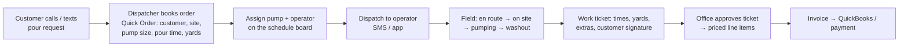
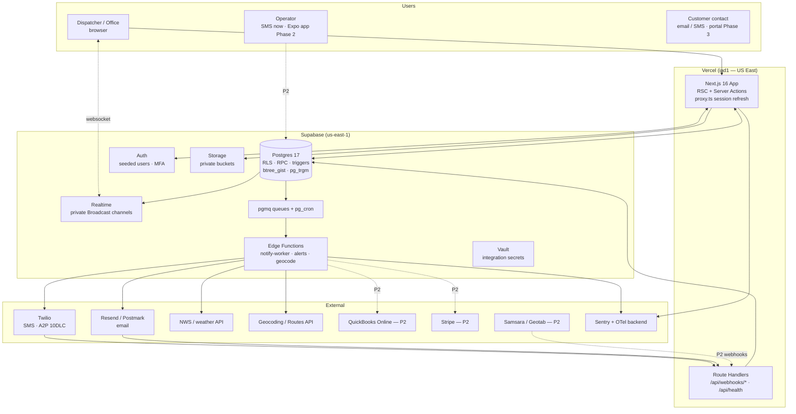
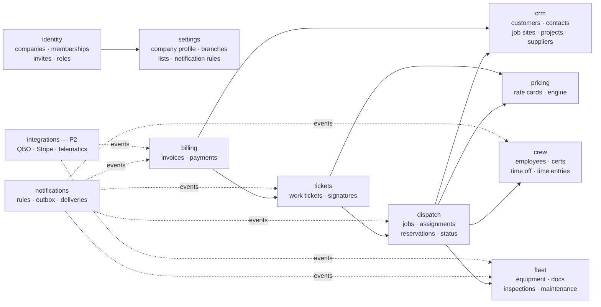
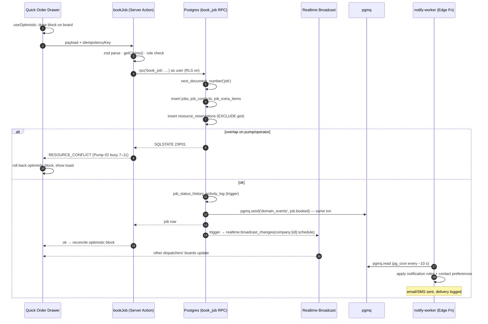
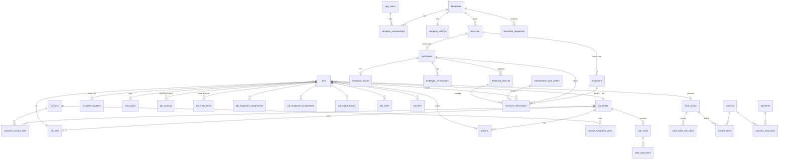
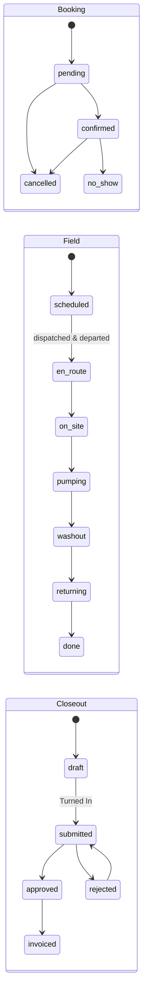
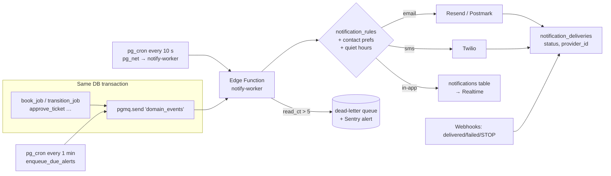
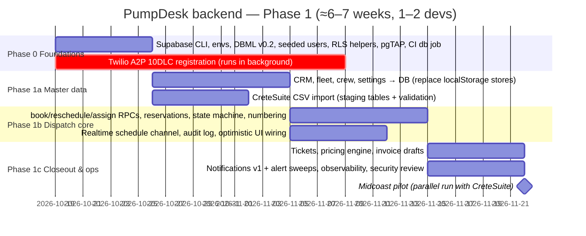
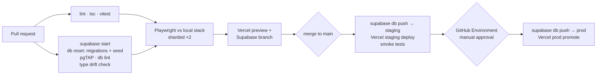

# PumpDesk — Backend Architecture (v1.2, October 2026)

> **v1.2:** launch checks from the design review (§19) and DBML v0.2 with all 56 tables, verified in Postgres (§19).
>
> **v1.1 changes:** tenant and role are now read live from `company_memberships` instead of a login-token claim (§5.2). Also new: Phase 1 seeded accounts (§5.1), deferrable double-booking constraints (§6.3), reads, dynamic routes and caching (§4.5), how one change reaches every screen (§9), and the full security checklist (§14). These were checked against current Supabase, Next.js 16 and PostgreSQL docs (§20).

> **Status:** Proposal for review. Nothing in this document has been implemented yet.
> **Scope:** The backend for Phase 1 (the core dispatch MVP), designed so Phase 2 (operator app, QuickBooks, payments, GPS) plugs in without a rewrite.
> **Source of truth:** `docs/pumpdesk-database.dbml` stays the schema authority. Section 6 lists the changes this design needs in DBML v0.2.

---

## 0. TL;DR — the decisions in one screen

| # | Decision | Why |
|---|---|---|
| 1 | **A modular monolith: Next.js 16 plus Supabase. No separate backend service.** | One team and one product. A company books about 10–40 pours a day. A single Postgres handles thousands of such tenants. Microservices would add cost and slow you down with no benefit. |
| 2 | **Postgres enforces the business rules.** Exclusion constraints, a state-machine function, RLS and audit triggers all live in the database. | Double-booking a pump is the worst bug PumpDesk can have, so the database itself has to make it impossible. |
| 3 | **One `resource_reservations` table** holds time blocks for every pump and operator: jobs, maintenance and time off. | A single exclusion constraint then covers all four conflicts: a pump double-booked, an operator double-booked, a pump in the shop, and an operator on leave. |
| 4 | **Job status is split into separate dimensions:** booking, dispatch, field progress and closeout. One overloaded enum is not used. | The UI already mixes `Pending/Confirmed`, `unassigned/draft/dispatched`, `travel/onsite/washout` and `Turned In`. Splitting them stops the state machine from tangling. |
| 5 | **Writes go through Server Actions, which call Postgres RPCs.** Reads go through a server-only data access layer (DAL). Route Handlers are used only for webhooks and cron. | Validation and tenant context are typed end to end. The same RPCs serve the Phase 2 mobile app. No GraphQL and no tRPC are needed. |
| 6 | **Tenancy uses `company_id` on every row. The caller's company and role are read live from `company_memberships`** by two cached helper functions. The login token only proves identity. | Removing someone or changing a role takes effect on their next request. A role inside the token would stay valid until the token expires. The cost is one indexed lookup per statement. |
| 7 | **Background work runs on pgmq (Supabase Queues), pg_cron and Edge Functions.** | `pgmq.send()` runs inside the booking transaction, so you get the outbox pattern for free and no new vendor. |
| 8 | **Realtime uses Broadcast from database triggers on private, per-company channels.** Postgres Changes is not used. | Broadcast scales better and the topic is authorized by RLS on `realtime.messages`. |
| 9 | **Pricing is a pure TypeScript engine.** Its output is snapshotted onto tickets and invoices when they are approved. | The quote preview, the ticket and the invoice all use the same math. Past invoices never change when rates change. |
| 10 | **Timezone comes from `companies.timezone`.** The hard-coded `America/Chicago` goes away. | Midcoast is in Warren, Maine, which is `America/New_York`. See finding F-4. |

---

## 1. What PumpDesk is (as understood from the repo)

PumpDesk is a multi-tenant SaaS for **concrete pumping companies**. It replaces CreteSuite for the first client, Midcoast Concrete Pumping (Warren, ME; chief dispatcher Jessie Black). The core loop:



**Domain entities** (from the UI and DBML): companies, branches/yards, users and memberships, employees/operators (CDL, med cert, emergency contacts, time off), customers, contacts (linked to several customer accounts with roles), job sites, projects, concrete suppliers, equipment (boom pumps 28/34/47 M, line pumps, documents, inspections, maintenance), jobs/orders, assignments, work tickets and their line items, rate cards (pump services plus extra charges such as travel, washout, extra hose and fuel surcharge), invoices, payments, notes, files, notification rules and contact preferences, tags, pour types, and the activity log.

---

## 2. Current state — findings from the deep dive

### 2.1 What exists

- **Frontend:** Next.js 16.2 App Router, React 19.2 with the React Compiler, Tailwind v4, shadcn, RHF + Zod, and nuqs. About 30k lines across 25 routes: schedule (day/week/list), orders and their dossier, new order, customers, contacts, operators, pumps, invoices (a stub), settings (company, pricing, lists, notifications, integrations), and auth (login, forgot, reset).
- **"Backend" today:** none. All data lives in the **browser's `localStorage`**: `orders-store.ts`, `pumps-store.ts`, `operators-store.ts`, `contacts-store.ts` and `settings-store.ts`. A `CustomEvent` keeps tabs in sync. Seed data is hard-coded.
- **Auth:** `src/lib/auth/auth-service.ts` is a deliberate stub. Every call succeeds after a fake delay. The good news is that this already gives the UI a clean service boundary to swap out.
- **Supabase:** `src/lib/supabase.ts` creates a bare anon client and **nothing imports it**. `.env.local` holds a placeholder anon key. There is no `supabase/` folder, no migrations, no seed and no generated types.
- **Schema design:** `docs/pumpdesk-database.dbml` v0.1 is solid: 33 tables, enums, tenant-scoped indexes. It is still a plan and has never been applied.
- **CI:** GitHub Actions runs lint, typecheck, unit tests and build. There is no database stage and no E2E stage yet.
- **Hosting:** a Vercel project is linked.

### 2.2 Gaps and inconsistencies to fix before building

| ID | Finding | Impact | Fix |
|---|---|---|---|
| F-1 | `PROJECT_SETUP_SPECIFICATION.md` puts the exclusion constraint on `orders.pump_id`, but the DBML has **`jobs` plus `job_equipment_assignments`** and no time range. | Double-booking protection can't be written as specced. | Use `resource_reservations` (§6.3). |
| F-2 | The spec's RLS uses a single `app_metadata.company_id`, but the DBML has **`company_memberships`** (multi-company, with roles). | Static `app_metadata` can't express role, and it goes stale when a membership changes. | Read company and role live from `company_memberships` (§5.2). |
| F-3 | The AGENTS.md RLS example `(SELECT auth.uid()) = user_id` fits user-owned rows. Operational rows are **company-owned**. | Copying it would produce wrong policies. | Use the tenant + role helpers (§5.3). |
| F-4 | AGENTS.md and the spec lock dates to **`America/Chicago`**, the DBML defaults to `America/New_York`, and Midcoast is in **Maine (Eastern)**. | Pours would show up an hour off, and "today" on the schedule would be wrong around midnight. | Make `companies.timezone` authoritative and format with it everywhere. |
| F-5 | The UI has concepts the DBML lacks: **branches/yards, tags, pour types, contact↔multiple-customer links with roles, contact notification preferences, notification/alert rules, emergency contacts, time off, prep/pump/cleanup durations, arrive-by, lines-on-site, min pump size, billing service, extra equipment items (hose), collect-on-delivery (COD), customer tier and dispatch note, per-pump hourly rate and minimum hours.** | Schema drift. | Bring the DBML to v0.2 (§6.4). |
| F-6 | `company_settings.next_job_number` / `next_invoice_number` are read-then-increment counters. | Two dispatchers can get the same number at the same moment. | Use `document_sequences` with `UPDATE … RETURNING` (§6.5). |
| F-7 | `jobs.office_notes` and `operator_notes` sit on the job row, and pricing would too. RLS is **row**-level. | An operator who can read a job could read office notes and prices. | Put notes in `job_notes.visibility` and keep money in tables operators can't read (§5.4). |
| F-8 | The spec lists `next-safe-action`, `husky`, `commitlint` and `@testing-library/react`, but **none are installed**. AGENTS.md requires approval before adding packages. | Spec and repo disagree. | See the approval list in §13. |
| F-9 | The README points to `docs/database.dbml`, but the real file is `docs/pumpdesk-database.dbml`. There is also an empty `Pumpdesk 2/` folder. | Small doc hygiene issue. | Fix in passing. |
| F-10 | The UI's order statuses (`Pending, Confirmed, Turned In, Completed, Cancelled`) don't match the DBML `job_status` (`draft … no_show`). | Ambiguous lifecycle. | Use the state model in §7. |

---

## 3. Target architecture

### 3.1 System context



**Co-locate everything in US East.** Set the Vercel Functions region to `iad1` and use Supabase `us-east-1`. Every server action does 1–3 database round-trips, and a cross-country hop would add 60–80 ms to each.

### 3.2 Layering inside the Next.js app

The app is organized as vertical feature slices, as the spec intended, with a strict server/client line:

```
src/
├── app/                      # routing only (pages, layouts, route handlers)
│   └── api/
│       ├── webhooks/{twilio,email,stripe,quickbooks}/route.ts
│       └── health/route.ts
├── features/
│   ├── dispatch/             # schedule board, booking, assignments
│   │   ├── components/       # client + server UI
│   │   ├── server/           # 'server-only': queries.ts, actions.ts, service.ts
│   │   ├── schemas.ts        # zod — shared by form + action + RPC payload
│   │   └── realtime.ts       # useScheduleChannel hook
│   ├── orders/  crm/  fleet/  crew/  tickets/  billing/  settings/  identity/
├── server/                   # cross-cutting, 'server-only'
│   ├── supabase.ts           # createServerClient (cookies) — user-scoped
│   ├── supabase-admin.ts     # secret key — ONLY for webhooks/cron
│   ├── session.ts            # getSession(): userId via getClaims(), companyId + role from memberships, React cache()
│   ├── action.ts             # authedAction / roleAction wrappers (zod, tenant, errors, tracing)
│   └── errors.ts             # Postgres SQLSTATE → domain errors (23P01 → ResourceConflict)
├── domain/                   # PURE TS, no I/O — unit-testable
│   ├── pricing/              # priceJob(), ticket totals, minimum hours, extras, tax
│   ├── job-state.ts          # allowed transitions (mirrors the SQL function)
│   └── time.ts               # company-timezone day boundaries, durations
└── types/database.types.ts   # generated by `supabase gen types`
```

**Rules:**

1. Any file under `server/` or `features/*/server/` starts with `import 'server-only'`.
2. Client components never import `@supabase/supabase-js` for data. The one exception is the Realtime subscription hook, which uses the browser client with the user's session.
3. Reads happen in Server Components through `features/*/server/queries.ts`. Writes go through Server Actions in `features/*/server/actions.ts`. Multi-row invariants go through **Postgres functions** called with `.rpc()`.
4. The existing `*-store.ts` files get replaced one domain at a time. Keep their exported function signatures as thin adapters during migration so pages change as little as possible (§12, Phase 1a).

### 3.3 Module boundaries (bounded contexts)



- Arrows mean "reads from / references". A module **writes only its own tables**.
- Modules talk to each other through **domain events** on the queue, not through direct calls. For example, `job.dispatched` leads the notifications module to send an SMS.
- All modules share one database. The boundaries are kept by folder structure and code review. If one ever needs extracting (most likely integrations), its seams are already in place.

---

## 4. API design

### 4.1 Style choice

| Option | Verdict |
|---|---|
| **Server Actions + Postgres RPC** | ✅ **Primary.** Typed from form to database, no hand-written endpoints, works with `useOptimistic` for the 30-second booking goal. |
| REST Route Handlers | ✅ Only for **inbound** traffic: webhooks (Twilio, email events, Stripe, QBO, telematics), cron hooks, health. |
| Supabase client + RPC from the mobile app (P2) | ✅ The Expo operator app calls the **same RPCs**, and RLS is the contract. No separate mobile API. |
| GraphQL / tRPC | ❌ Unneeded. Server Actions plus generated database types already give end-to-end types. |
| Public versioned `/api/v1` | ⏸ Only when a third party (for example a ready-mix supplier) needs access. Phase 3+. |

### 4.2 The action wrapper (`server/action.ts`)

Every mutation goes through one wrapper, either `next-safe-action` (subject to approval) or a small in-house wrapper. It:

1. Parses input with the feature's Zod schema, using **strict object schemas that list only the fields the action may change**. **Server Actions are public endpoints**, so they must never trust the client. The parsed object, never the raw form, goes to the database, which blocks mass-assignment of `status`, `company_id`, `approved_by` and similar fields.
2. Resolves the session with `supabase.auth.getClaims()`. The JWT is verified locally with **asymmetric signing keys**, so there's no network hop to Auth. Every action does this itself. Next.js warns not to rely on `proxy.ts` for authorization, because a matcher change can silently skip a Server Action.
3. Reads `{ companyId, role }` from `company_memberships` once per request (React `cache()`) and checks the role against the action's allow-list. This is the UX-level check; RLS re-checks the same live membership.
4. Accepts an `idempotencyKey`, a UUID the client generates per submit, for create actions. A double-clicked "Book" makes exactly one job.
5. Opens an OpenTelemetry span with `company_id`, `action` and `user_id` attributes.
6. Maps Postgres errors to typed results, for example `23P01` → `{ ok:false, code:'RESOURCE_CONFLICT', conflict:{resource:'Pump 02', from, to} }` and `P0001` (raised by the state machine) → `INVALID_TRANSITION`.
7. Returns `{ ok: true, data }` or a typed error and **never throws raw database errors to the client**.

### 4.3 Key operations

| Module | Operation | Kind | Notes |
|---|---|---|---|
| identity | `inviteMember`, `acceptInvite`, `changeRole`, `suspendMember`, `switchCompany` | action + Auth admin | No public sign-up. **Phase 1 seeds accounts** (§5.1); the invite screens come later. `suspendMember` blocks the person on their next request, then bans the Auth user and signs out their sessions. `switchCompany` sets `app_metadata.active_company_id` (server-only, so the user can't edit it). That value is a preference, still validated against memberships. |
| crm | `upsertCustomer`, `archiveCustomer`, `upsertContact`, `linkContactToCustomer`, `upsertJobSite` | action | `archive*` sets `archived_at`. DELETE is never granted. |
| fleet | `upsertEquipment`, `scheduleMaintenance` | action → RPC | Maintenance creates a **reservation**, so the pump drops out of the schedule. |
| crew | `upsertEmployee`, `requestTimeOff`, `approveTimeOff`, `upsertCertification` | action → RPC | Approved time off creates a reservation. |
| dispatch | **`book_job`** | RPC | Single transaction: allocate the number, insert the job, its contacts and extras, the optional assignment and reservations, write status history, enqueue `job.booked`. |
| dispatch | **`reschedule_job`**, **`assign_resources`**, `unassign_resource` | RPC | Moves reservations and lets the exclusion constraint arbitrate. Used by drag-and-drop on the board. |
| dispatch | **`transition_job`**`(job_id, dimension, to, reason)` | RPC | The only path that changes status. Validated against the transition table and writes history. |
| dispatch | `dispatchJob` | action → RPC | Sets `dispatched_at` and enqueues `job.dispatched`, which leads to the operator SMS. |
| tickets | `openTicket`, `saveTicket`, `submitTicket`, **`approve_ticket`** | action / RPC | Approval runs the pricing engine, snapshots line items and locks the ticket. |
| billing | **`create_invoice`**`(ticket_ids[])`, `voidInvoice`, `recordPayment` | RPC | Totals are computed in SQL from line items, never sent by the client. |
| settings | `updateCompany`, `upsertRateCard`, `upsertNotificationRule`, `upsertList(pour_types/tags)` | action | |
| reads | `schedule_day(date)`, `schedule_range(from,to)` | SQL function (STABLE) | Returns the lanes (pumps), their reservations and the unassigned jobs in one round-trip. |
| reads | Orders, customers and contacts directories | DAL query | **Keyset pagination** on `(scheduled_start, id)`, filters through nuqs, search with `pg_trgm`. |

### 4.4 Booking flow (the critical path)



### 4.5 Reads, dynamic routes and caching

**Where reads happen:**
- Every page gets its first data from the **server** (Server Components). The browser never queries business tables directly.
- Client navigation fetches the next page's server-rendered payload and swaps it in, so it feels like a single-page app without a reload.
- **Server Actions are for writes only.** They are POST requests and run one at a time, so reads through them would queue up.

**Dynamic routes** (`orders/[id]`, `customers/[id]`, `contacts/[id]`, `operators/[id]`):

```tsx
// src/app/(app)/orders/[id]/page.tsx
export default async function OrderPage({ params }: { params: Promise<{ id: string }> }) {
  const { id } = await params;                // Next 16: params is a Promise
  const order = await getOrderByNumber(id);   // server-only query, RLS applies
  if (!order) notFound();                     // missing OR another company's: same 404
  return <OrderDetailView order={order} />;   // existing client component, now fed by props
}
```

- Orders use the readable number in the URL (`/orders/ORD-1525`). It's unique per company through `(company_id, job_number)`.
- No `generateStaticParams`: the data is private and changes constantly. Use a `loading.tsx` skeleton per segment.
- `searchParams` (schedule date, filters, open drawer via nuqs) is also a Promise in Next 16.

**Browser-side fetches after load** (the only ones):

| Case | How |
|---|---|
| Customer search-as-you-type | A GET Route Handler (`/api/search`), session-checked, RLS applies |
| "Load more" on long lists | Keyset cursor through the same pattern |
| Live updates | The Realtime private channel (nudges only, no data) |

Small lists (pumps, operators, pour types) are loaded with the page.

**Caching:** start with almost none. A stale schedule (a pump that looks free but isn't) is the most expensive bug, and Postgres answers these queries in milliseconds.

| Level | Use | For |
|---|---|---|
| Per request: React `cache()` | Day 1 | Session and membership read once per render |
| Across requests: `use cache` + `cacheTag` | Only if measured as slow | Rarely changing lists (pour types, rate cards, settings), tagged `company:{id}:settings`, cleared with `updateTag` on save. Cached scopes can't read `cookies()`, so they must take `companyId` as an argument and hold only non-sensitive data. On Vercel the default in-memory cache is per instance and often not reused anyway |
| Redis / Upstash | Not now | Only for custom rate limiting |

**Never cache** the schedule, orders, availability, tickets or invoices.

---

## 5. Authentication & authorization

### 5.1 Auth

- **Supabase Auth** with email and password. The UI for login, forgot and reset already exists, and `auth-service.ts` is the only file that changes.
- **Phase 1 uses seeded accounts.** Public sign-up is off. Each person is a **real** Supabase Auth user, created up front with the Auth admin API in a seed script or from the dashboard. Each one also gets a `company_memberships` row (`status='active'`, with a role).
  - Passwords are never written in the code. Local-only test users with test passwords live in `supabase/seed.sql`.
  - Don't hard-code an email and password check in app code. The database couldn't tell users apart, RLS, the activity log and Realtime authorization would all break, and it would have to be ripped out later.
  - The invite flow (`inviteMember` / `acceptInvite`) comes later and only adds screens.
- **MFA (TOTP) is required** for `owner`, `admin` and `accountant`. Enforce it in RLS for money-sensitive tables by checking `auth.jwt()->>'aal' = 'aal2'`.
- Use `@supabase/ssr` for cookie sessions (needs approval). **`proxy.ts`** (Next 16's rename of middleware) only refreshes the session and applies the cache headers it is given. Authorization happens in every page and Server Action through `getClaims()`. Never trust `getSession()` on the server.
- Use the **new API keys** and **asymmetric JWT signing keys**. The env names are `NEXT_PUBLIC_SUPABASE_URL`, `NEXT_PUBLIC_SUPABASE_PUBLISHABLE_KEY` (browser) and `SUPABASE_SECRET_KEY` (server only). Rename today's `NEXT_PUBLIC_SUPABASE_ANON_KEY` and rotate the legacy anon and service_role keys out.
- **Allow redirects only** to PumpDesk's own URLs in the Auth settings, so reset and magic links can't send users to another site.
- **Removing a person:**
  1. `suspendMember` sets the membership to `suspended`. Because RLS reads memberships live (§5.2), their **next request is blocked even though their access token is still valid**.
  2. The person is then banned in Supabase Auth and their sessions are signed out, so they can't get a new token.
  3. An already-open Realtime socket may keep receiving "something changed" nudges until it reconnects. Nudges carry no business data, and the refetch they trigger is refused by RLS.
- Phase 2 operators sign in with a phone number + SMS OTP or a magic link. They won't remember passwords.

### 5.2 Tenant and role, read live from memberships

The access token only proves **who** the user is. **Which company they belong to and what role they hold** are read live from `company_memberships` by two helper functions.

**Why not put the role in the token?** That's the earlier design, with a Custom Access Token Hook. Supabase's own RBAC guide uses it. But a role baked into the token stays valid until the token expires, and signing the user out does not kill an access token that was already issued. A fired dispatcher could keep editing for up to the token lifetime. The large Supabase SaaS kits (MakerKit, Basejump) check membership in the database for the same reason.

```sql
create schema if not exists private;          -- not exposed through the Data API
grant usage on schema private to authenticated;

-- The caller's active company. A user in several companies may set app_metadata.active_company_id
-- (server-only); it is a preference, still validated against an active membership.
create function private.company_id() returns uuid
language sql stable security definer set search_path = '' as $$
  select m.company_id
  from public.company_memberships m
  where m.user_id = auth.uid()
    and m.status = 'active'
  order by (m.company_id = nullif(auth.jwt() -> 'app_metadata' ->> 'active_company_id', '')::uuid) desc nulls last,
           m.joined_at
  limit 1
$$;

create function private.has_role(roles public.membership_role[]) returns boolean
language sql stable security definer set search_path = '' as $$
  select exists (
    select 1 from public.company_memberships m
    where m.user_id = auth.uid()
      and m.status = 'active'
      and m.company_id = private.company_id()
      and m.role = any (roles)
  )
$$;

revoke execute on function private.company_id(), private.has_role(public.membership_role[]) from public, anon;
grant  execute on function private.company_id(), private.has_role(public.membership_role[]) to authenticated;

create index on public.company_memberships (user_id, status);
```

**Cost:** policies call these helpers as `(select private.company_id())`. Postgres runs them **once per statement** (an initPlan), so each query pays one indexed lookup, not one per row.

**Protecting the memberships table itself** (privilege escalation):
- Members can read only their own company's memberships.
- Only `owner` / `admin` can insert or update rows.
- A `BEFORE UPDATE` trigger refuses three things: changing **your own** role or status, an admin granting `owner`, and removing or downgrading the **last owner**.

### 5.3 RLS policy pattern

```sql
-- Pattern for every operational table (example: jobs)
alter table public.jobs enable row level security;

create policy jobs_read on public.jobs for select to authenticated
  using ( company_id = (select private.company_id()) );

create policy jobs_insert on public.jobs for insert to authenticated
  with check ( company_id = (select private.company_id())
               and (select private.has_role('{owner,admin,dispatcher,office}')) );

create policy jobs_update on public.jobs for update to authenticated
  using      ( company_id = (select private.company_id()) )
  with check ( company_id = (select private.company_id())
               and (select private.has_role('{owner,admin,dispatcher,office}')) );

-- No DELETE policy → hard deletes are impossible from the API (soft-delete rule enforced by the DB).
revoke delete on public.jobs from authenticated, anon;
-- Logged-out visitors get nothing at all on business tables:
revoke all on public.jobs from anon;
```

**Rules:**
- **Performance:** always wrap helpers in `(select …)`. Make **every** index lead with `company_id`, and index every column a policy filters on. Always name the role (`to authenticated`).
- **Columns:** RLS filters rows. On top of it, grant `update` only on the columns each role may change. A trigger forces `company_id`, document numbers, `created_by` / `created_at` (from `auth.uid()` and `now()`) and approval fields to be unchangeable from the API.
- **Views:** views skip RLS by default, so every view (for example `jobs_display`) is created `with (security_invoker = true)`.
- **Functions:** Postgres grants `EXECUTE` on new functions to `PUBLIC` by default. Revoke it from `public, anon` on every function, and grant to `authenticated` only what the app calls. `security definer` functions use `set search_path = ''`, fully qualified names, and check the caller's role inside.

### 5.4 Role matrix (Phase 1; operator rows matter in Phase 2)

| Capability | owner | admin | dispatcher | office | accountant | mechanic | operator | read_only |
|---|---|---|---|---|---|---|---|---|
| Company settings, members, rate cards | ✅ | ✅ | – | – | – | – | – | – |
| Book / reschedule / assign / dispatch | ✅ | ✅ | ✅ | ✅ | – | – | – | – |
| CRM edit | ✅ | ✅ | ✅ | ✅ | ✅ | – | – | – |
| Fleet edit, maintenance | ✅ | ✅ | ✅ | – | – | ✅ | – | – |
| Approve tickets, invoices, payments | ✅ | ✅ | – | – | ✅ | – | – | – |
| See prices, invoices | ✅ | ✅ | ✅ | ✅ | ✅ | – | – | – |
| See **own assigned** jobs, submit ticket | ✅ | ✅ | ✅ | ✅ | – | – | ✅ | – |
| Read everything (non-financial) | ✅ | ✅ | ✅ | ✅ | ✅ | ✅ | – | ✅ |

- **Operator scoping:** a policy using `private.is_assigned_to_job(job_id)`, a `security definer` helper that joins `job_employee_assignments` to `employees.user_id = auth.uid()`.
- **Column-level privacy:** RLS works on rows, so data that some roles mustn't see lives in **separate tables**:
  - `job_notes.visibility` (internal / operator / customer) replaces `jobs.office_notes`.
  - Prices live in `job_pricing`, `work_ticket_line_items` and `invoices`, and operators have no policy on them.
  - Emergency contacts, CDL numbers and medical certificates live in `employee_private`, readable by owner, admin and the employee themself.

---

## 6. Data model

### 6.1 Conventions

- `id uuid primary key default gen_random_uuid()`. For high-insert tables (`activity_log`, `notification_deliveries`), use `uuidv7()` (native in PG 18; use the `pg_uuidv7` extension or an SQL function until then) for index locality.
- Every operational table has `company_id uuid not null references companies(id)`, plus a **composite FK** where it matters, `(company_id, customer_id) references customers(company_id, id)`. That makes a cross-tenant reference impossible even if the app has a bug.
- `created_at`, `updated_at` (via a `moddatetime` trigger), and `created_by` / `updated_by` defaulting to `auth.uid()`.
- **Soft delete:** keep `is_active` as AGENTS.md says, and add `archived_at` and `archived_by` so you know when. Never grant `DELETE` on core tables.
- Money is `numeric(12,2)` in SQL and **integer cents** in TypeScript. Quantities are `numeric(12,3)`. Never use float.
- Time is `timestamptz` in UTC. `jobs.service_date date` is computed in the company timezone by trigger, so "jobs on Oct 16" is an index lookup.
- Enums are Postgres enums for stable lifecycles. **Lookup tables** (`pour_types`, `tags`) hold company-editable lists.

### 6.2 Core ERD (Phase 1 scope; billing tables shown for shape)



### 6.3 Double-booking prevention with `resource_reservations`

```sql
create extension if not exists btree_gist;

create type reservation_source as enum ('job', 'maintenance', 'time_off', 'hold');

create table public.resource_reservations (
  id            uuid primary key default gen_random_uuid(),
  company_id    uuid not null references public.companies(id),
  equipment_id  uuid references public.equipment(id),
  employee_id   uuid references public.employees(id),
  period        tstzrange not null check (not isempty(period)),
  source_type   reservation_source not null,
  source_id     uuid not null,
  is_hard       boolean not null default true,   -- tentative holds = false (warn, don't block)
  released_at   timestamptz,
  created_by    uuid default auth.uid(),
  created_at    timestamptz not null default now(),
  check (num_nonnulls(equipment_id, employee_id) = 1),

  constraint no_equipment_overlap exclude using gist
    (company_id with =, equipment_id with =, period with &&)
    where (is_hard and released_at is null and equipment_id is not null)
    deferrable initially deferred,

  constraint no_employee_overlap exclude using gist
    (company_id with =, employee_id with =, period with &&)
    where (is_hard and released_at is null and employee_id is not null)
    deferrable initially deferred
);

create index on public.resource_reservations using gist (company_id, period)
  where released_at is null;
```

- **What a job reserves:** yard departure to yard return, not just the pour. That is `period = [scheduled_start − travel − prep, scheduled_end + cleanup + travel)`. A trigger on `jobs` keeps the reservation in sync when times change.
- **Soft vs hard:** a `pending` order reserves softly (`is_hard=false`). It shows as a striped block with an overlap warning, because dispatchers sometimes double-pencil on purpose. Confirming the order flips it to hard, and that is when the constraint can refuse.
- **Deferred check:** the constraints are `deferrable initially deferred`, so they are checked at **commit**, not per row. Swapping two jobs between two pumps in one `assign_resources` call works, and only the final state must be overlap-free. Prove this with a pgTAP test in Phase 0.
- **Overruns:** extending a job that now overlaps the pump's next job is refused (`23P01`). The UI turns that into an "extend → resolve the knock-on job" flow (move or reassign the next job) instead of a dead-end error.
- **Maintenance windows and approved time off** write reservations too. The schedule board then greys them out with no extra logic.
- Postgres `tstzrange` treats the range as `[)` (end-exclusive), so back-to-back jobs (7–11 and 11–3) are allowed.

### 6.4 DBML v0.2 changes (reconciling with the UI)

| Change | Reason |
|---|---|
| **+ `branches`** (name, code, address, lat/lng, phone, is_hq). Add `branch_id` to equipment and employees. | Settings → Branches, and yard-based travel time. |
| **`customer_contacts` → `contacts` + `customer_contact_links(contact_id, customer_id, roles text[], is_primary)`** | The UI links one contact to many customer accounts with roles. |
| **+ `job_contacts(job_id, contact_id, role)`** | Site contact and additional contacts per order. |
| **+ `contact_notification_prefs(contact_id, event_type, channel)`** | The contact dossier's notification preferences. |
| **+ `notification_rules(company_id, audience customer/office, event_type, channel, offset_minutes, recipients, enabled)`** | Settings → Notifications (customer messages plus office alerts). |
| **+ `pour_types`, `tags`, `customer_tags`, `job_tags`, `contact_tags`** | Settings → Lists. Use real join tables, not polymorphic ones, so FKs stay enforced. |
| **jobs: + `job_name`, `arrive_by`, `travel_minutes`, `prep_minutes`, `pump_minutes`, `cleanup_minutes`, `lines_on_site`, `min_boom_length_m`, `billing_item_id`, `collect_on_delivery`, `pour_type_id`, `service_date`, `booking_status`, `dispatch_status`, `field_status`, `dispatched_at`, `acknowledged_at`, `idempotency_key`**. Remove `office_notes` and `operator_notes` (they move to job_notes). | The New Order form and the state model in §7. |
| **+ `job_extra_items(job_id, rate_card_item_id, quantity)`** | Extra hose (per foot), off-site washout, fuel surcharge. |
| **customers: + `tier`, `dispatch_note`, `credit_hold boolean`** | Customer directory badges, and "Confirm PO before scheduling". |
| **equipment: + `hourly_rate_override`, `min_hours_override`, `default_operator_id`** | Pump detail view. Defaults come from the rate card by equipment class. |
| **+ `employee_private`, `employee_emergency_contacts`, `employee_time_off`** | Operator dossier. PII is kept apart (§5.4). |
| **rate_card_items: + `pricing_model` (`hourly_min`, `per_unit`, `flat`), `equipment_class`, `min_quantity`** | Pricing settings: "34m boom pump $250/h, 4 h min", "Extra hose $2/ft". |
| **− `company_settings.next_*_number` → `document_sequences`** | F-6. |
| **+ `resource_reservations`** | §6.3. |
| **+ `idempotency_keys`, `notification_deliveries`, `job_alerts`, `integration_connections`, `import_batches`** | Platform tables (§8, §12). |
| `companies.timezone`: no default. It is required at onboarding. | F-4. |

### 6.5 Document numbers without races

```sql
create table public.document_sequences (
  company_id uuid not null references public.companies(id),
  doc_type   text not null check (doc_type in ('job','ticket','invoice','work_order')),
  prefix     text not null,
  next_value bigint not null default 1,
  primary key (company_id, doc_type)
);

create function private.next_document_number(p_type text) returns text
language sql volatile as $$
  update public.document_sequences
     set next_value = next_value + 1
   where company_id = (select private.company_id()) and doc_type = p_type
  returning prefix || (next_value - 1)::text
$$;
```

The row lock serializes concurrent bookings for that company only, and it is held for milliseconds. Numbers stay gapless unless a transaction rolls back, which is acceptable for jobs. For invoices, allocate the number at **send** time, not at draft time.

### 6.6 Indexes worth calling out

- `jobs (company_id, service_date, scheduled_start)`: the schedule board.
- `jobs (company_id, booking_status, scheduled_start desc, id)`: the orders directory with keyset paging.
- `jobs (company_id, customer_id, scheduled_start desc)`: the customer dossier.
- GIN `pg_trgm` on `customers.business_name`, `contacts (first_name || ' ' || last_name)`, `job_sites.address_line_1`: the fuzzy search behind a ⌘K command palette.
- Partial indexes for the alerts sweep: `jobs (scheduled_start) where booking_status='confirmed' and dispatch_status <> 'dispatched'`.
- `employee_certifications (company_id, expiration_date)` and `equipment_documents (company_id, expiration_date)`: expiry alerts.

### 6.7 Audit trail

- `activity_log` is fed by **one generic trigger** on core tables. It stores `actor`, `entity`, `action`, and a `diff jsonb` holding only the changed columns. It is append-only: grant INSERT only to the trigger owner and give no UPDATE or DELETE to anyone.
- Partition it by month once it passes about 10M rows. That is years away.
- The order dossier's history tab reads `job_status_history` together with `activity_log`.

---

## 7. Job lifecycle — four status dimensions

A single `job_status` enum tries to describe four separate things. Split it:

| Dimension | Values | Who changes it |
|---|---|---|
| `booking_status` | `pending → confirmed → cancelled` (and `no_show`) | Office |
| `dispatch_status` | `unassigned → assigned → dispatched → acknowledged` | Derived from assignments, plus the dispatch action and the operator's ack |
| `field_status` | `scheduled → en_route → on_site → pumping → washout → returning → done` | The dispatcher in P1; the operator app or telematics geofences in P2 |
| `closeout_status` (on `work_tickets.status`) | `draft → submitted (Turned In) → approved → invoiced` (and `rejected`, `void`) | Operator and office |



- The UI's single "status chip" is a **derived display status**, computed in one SQL view (`jobs_display`, created `with (security_invoker = true)` so RLS still applies) or one TS function, so every screen agrees.
- `transition_job()` is the only writer of these columns (a `BEFORE UPDATE` trigger rejects direct changes). It checks the allowed-transition table, sets the timestamps (`confirmed_at`, `dispatched_at` …), writes `job_status_history`, and enqueues a domain event.
- Cancelling a job **releases** its reservations and sets `released_at` instead of deleting them, so the history survives.

---

## 8. Background jobs, events & notifications

### 8.1 Pipeline



- **Outbox for free.** `pgmq.send()` is an insert, so it commits or rolls back with the booking. There are no lost and no phantom notifications. pgmq's docs don't state this explicitly; it follows from queues being ordinary Postgres tables, and a Phase 0 pgTAP test proves it. Wrap it in a `security definer` `private.emit_event(type, payload)` helper so `authenticated` never needs grants on the `pgmq` schema.
- **Idempotency.** Each delivery has a unique `(event_id, recipient, channel)`. A retried worker can never double-text a superintendent.
- **Visibility timeout and retries.** Read with `vt = 60s`, archive on success, retry with exponential backoff, and move to the dead-letter queue (DLQ) after 5 attempts.

### 8.2 Scheduled work (pg_cron)

| Job | Cadence | From settings |
|---|---|---|
| `enqueue_due_alerts()` | 1 min | "Job missing pump or operator, 60 min before arrival"; "Assignment not acknowledged, 30 min before departure"; "Work ticket missing, 2 h after job ends". Deduped by a unique `job_alerts(job_id, rule_key)`. |
| `drain notify queue` | 10 s | Calls the `notify-worker` Edge Function through `pg_net`. |
| `credential_expiry_sweep()` | Daily 06:00 company time | CDL, medical certificate, equipment documents, inspections (the operator dossier's "CDL expires in 20 days"). |
| `tomorrow_digest()` | Daily 15:00 | Confirmation requests to customers for tomorrow's pours (the "Order confirmation" rule). |
| `geocode_pending_sites()` | 5 min | Fills in job site lat/lng for directions URLs and, later, travel time. |
| Housekeeping | Nightly | Purge `idempotency_keys` older than 48 h, archive pgmq, refresh reporting materialized views (P3). |

### 8.3 Providers

- **Email:** Resend (React Email templates live in the repo) or Postmark (stronger transactional deliverability). Either works. Set up SPF, DKIM and DMARC on a sending subdomain per company, or on a shared `notify.pumpdesk.app` with a reply-to.
- **SMS:** Twilio. ⚠️ **Start A2P 10DLC brand and campaign registration in week 1.** US carrier approval takes days to weeks, and unregistered traffic gets filtered. Handle inbound `STOP`/`HELP` and store opt-outs in `sms_opt_outs`.
- **Message templates** are stored per company and rendered by the worker with the job context. In-app notifications go to the `notifications` table and reach the browser over Realtime.

### 8.4 When to graduate

If Phase 2 brings long, multi-step workflows (for example a QuickBooks sync with OAuth refresh, paging and conflict resolution), consider **Inngest** or **Trigger.dev** for durable steps. Keep pgmq for the transactional outbox. Not needed in Phase 1.

---

## 9. Realtime

- **Use cases:**
  - Several dispatchers on the same schedule board.
  - Live field-status chips (P2 operator app).
  - In-app notifications.
  - Presence ("Jessie is editing ORD-1525"), which gives a soft lock on the dossier.
- **Mechanism:** an `AFTER INSERT/UPDATE` trigger on `jobs`, `resource_reservations` and `job_*_assignments` calls `realtime.broadcast_changes()` to a **private** topic `company:{company_id}:schedule`.

```sql
create policy "company members receive their topics"
on realtime.messages for select to authenticated
using ( realtime.topic() like 'company:' || (select private.company_id())::text || ':%' );
```

- **Receive-only:** there is a `select` policy on `realtime.messages` and **no `insert` policy**, so users can't send their own channel messages. The one exception is presence, which gets a narrow insert policy for the `presence` extension on `company:{id}:order:{orderId}` topics.
- **One nudge per change:** the trigger sends a single small message per transaction (for example `{ day: '2026-10-16', job: 'ORD-1525' }`), not one per touched row. A drag touches the job, reservations and assignments, and the client debounces nudges (~250 ms) before refetching.
- **Client contract:** a payload is a **hint**, not the truth, and it carries no business data. The `useScheduleChannel` hook calls `router.refresh()` (or refetches `schedule_day(date)`) when the nudge concerns the visible day. On `visibilitychange` → visible, or on reconnect, it always refetches. This covers the lunch-break and laptop-sleep case from the spec.
- **Why Broadcast, not Postgres Changes:** Supabase recommends Broadcast "for scalability and security". Postgres Changes authorizes every event against every subscriber on a single thread. It would cope at PumpDesk's size (Supabase cites ~3,000 concurrent subscribers on the same changes as the point to switch), so Broadcast here is headroom, not a necessity.

| Channel | Used by |
|---|---|
| `company:{id}:schedule` | Schedule board |
| `company:{id}:user:{userId}` | In-app alerts |
| `company:{id}:order:{orderId}` | Order dossier refresh + presence ("Jessie is editing") |

### 9.1 How one change reaches every screen

Example: Jessie and Sarah both have `/orders/ORD-1525` open, and Jessie changes the pour time to 9:30.

| Who | How they see it |
|---|---|
| **Jessie (made the change)** | `useOptimistic` shows 9:30 at once. The Server Action saves it, then calls `refresh()` / `revalidatePath()`, so the fresh server-rendered order comes back **in the same response**. On failure (for example `RESOURCE_CONFLICT`) the optimistic value rolls back with the reason. She needs no channel. |
| **Sarah (page open)** | A trigger nudge arrives on `company:{id}:order:{orderId}`. Her page calls `router.refresh()`, and the server re-reads the order under RLS. |
| **Anyone opening it later** | The normal server render, already fresh. |

Pages without a channel (customers, contacts, pumps, operators, settings) are simply fresh on every visit.

---

## 10. File storage

| Bucket (all private) | Path | Read | Write | Limits |
|---|---|---|---|---|
| `company-assets` | `{company_id}/logo/{uuid}.png` | members | owner/admin | 2 MB, image/* |
| `equipment-docs` | `{company_id}/{equipment_id}/{uuid}.pdf` | members (not operators) | admin/dispatcher/mechanic | 20 MB, pdf/image |
| `employee-docs` | `{company_id}/{employee_id}/{uuid}` | owner/admin + self | owner/admin | 20 MB, pdf/image |
| `job-files` | `{company_id}/{job_id}/{uuid}` | members (visibility-filtered) | office roles, assigned operator | 25 MB |
| `ticket-signatures` | `{company_id}/{ticket_id}/signature.png` | office roles | assigned operator (P2) | 512 KB, image/png |

- Storage RLS checks the path prefix: `(storage.foldername(name))[1]::uuid = (select private.company_id())`, plus role checks.
- Uploads use **signed upload URLs** created in a Server Action, so the browser uploads straight to Storage and the bytes never pass through Vercel. Downloads use short-lived signed URLs of about 5 minutes.
- A metadata row (`job_files`, `equipment_documents` …) is written **after** the upload is confirmed. A nightly sweep removes orphaned objects.
- Signed tickets are evidence for billing disputes. Store the signature image together with the ticket's `sha256` hash and a timestamp at signing time.

---

## 11. Pricing engine

- **Where:** `src/domain/pricing/`. It is pure TypeScript with no I/O and is shared by the order form preview, ticket approval and invoice creation. The inline function in `tests/unit/rates.test.ts` becomes a real module.
- **Input:** the job (equipment class, durations, yards, extras, travel), the effective rate card (the customer override if one is active on the service date, otherwise the company default), the tax rate and the customer's tax-exempt flag.
- **Output:** `LineItem[]`, each holding `{code, description, qty, unit, unit_price_cents, amount_cents, source_rate_item_id}`, plus totals.
- **Rules from settings:**
  - Pump service is hourly with a minimum: `max(hours, min_hours) × rate`, with optional overtime past N hours.
  - Travel is per hour.
  - Extra hose is per foot.
  - Washout and fuel surcharge are per job.
  - Maine sales tax is 5.5%, and is configurable.
- **Snapshotting:** `approve_ticket` writes the computed line items onto `work_ticket_line_items`, recording which rate item was used. From then on the ticket's money is **frozen**. Changing rates later never rewrites history.
- **Defense in depth:** the RPC recomputes totals in SQL from the line items (`sum(amount)`), and a check constraint holds `total = subtotal + tax − discount`.

---

## 12. Implementation roadmap



### Phase 0 — Foundations (week 1)

1. `supabase init`. Commit `supabase/config.toml`, `migrations/` and `seed.sql` (Midcoast's 4 pumps, operators, 10 customers, rate card).
2. Environments:
   - local (Docker via the Supabase CLI)
   - **preview** (Supabase Branching per PR, linked to Vercel previews)
   - staging
   - production
   All in US East.
3. Update the DBML to v0.2 (§6.4). Then write migration `0001_tenancy_identity.sql` (companies, users, memberships and their protection trigger, settings, branches, sequences, `private` helpers), plus seeded users for Midcoast, one per role.
4. Get the auth path working end to end: `@supabase/ssr`, `proxy.ts`, `server/session.ts`, and a real `auth-service.ts`. Remove the fake latency.
5. Set up pgTAP: write **tenant-isolation tests first**. User A of company X must not be able to see or modify company Y.
6. Add a database job to CI (§15). Add `npm run db:types` and fail CI when the generated types drift.

### Phase 1a — Master data (weeks 2–3)

- Migrations for customers, contacts and links, job sites, projects, suppliers, equipment and docs, employees and private data, certifications, time off, pour types, tags, rate cards, notification rules.
- Move one store at a time: `settings-store` → `contacts-store` → `pumps-store` → `operators-store`. Each becomes `features/<x>/server/{queries,actions}.ts`, and pages turn into Server Components that pass data to the existing client components.
- **CreteSuite import:** CSV upload into `import_batches` and staging tables, a validation report (duplicates, missing addresses), then a commit step. This is how Midcoast gets 84 customers and 142 sites into PumpDesk on day 1.

### Phase 1b — Dispatch core (weeks 3–5)

- `jobs`, `job_contacts`, `job_extra_items`, assignments, `resource_reservations` with exclusion constraints, `transition_job`, `book_job`, `reschedule_job`, `assign_resources`, `schedule_day()`.
- Wire the board: `useOptimistic` for drag and book, conflict toasts from `RESOURCE_CONFLICT`, and the Realtime channel hook.
- Load-test the board: 3 dispatchers × 50 drags per minute on one day. Expect p95 action latency under 300 ms.

### Phase 1c — Closeout & ops (weeks 5–6)

- Work tickets (office-entered in P1), the pricing engine, `approve_ticket` snapshotting, draft invoices (PDF via a React-PDF Edge Function or a server route; needs approval).
- Notifications v1: order confirmation email, operator dispatch SMS, the three office alerts, credential expiry.
- Observability dashboards, rate limits, a security review (§14), and a backup/restore drill.
- **Pilot:** run in parallel with CreteSuite for 1–2 weeks, then cut over.

### Phase 2 — Field & money (out of Phase 1 scope by AGENTS.md; the design already supports it)

- **Operator app (Expo/React Native).** Offline-first ticket capture. Consider PowerSync or a hand-rolled mutation queue against the same RPCs. Covers status taps, photos, signature capture and acknowledgements.
- **QuickBooks Online sync.** OAuth tokens in **Supabase Vault**, approved tickets and invoices pushed through the queue, a webhook for payment status, and `integration_connections` plus a sync log.
- **Stripe payments.** Use **Stripe Connect** (each pumping company is a connected account) for card and ACH invoice payment links. Webhook to `payments` and `payment_allocations`, idempotent on `processor_payment_id`.
- **Telematics** (Samsara or Geotab webhooks). Geofence enter and exit automatically drives `field_status`, and positions go into a `vehicle_positions` table (time-partitioned).
- **Weather/wind safety.** A forecast per job site for the next day, and a wind-threshold alert for boom pumps (the HUD already shows wind).

### Phase 3 — Intelligence & scale

- **AI dispatch assistant.** An LLM with tool calling (for example Claude) whose tools are the same DAL reads and RPCs: "find a 34 M for Thursday 7 AM", "draft an order from this text message", "who's free after 1 PM". The AI never writes directly. It **proposes** an action and the dispatcher confirms.
- Reporting: a `reporting` schema with materialized views (yards per pump per week, utilization %, revenue per customer), refreshed by pg_cron.
- Customer portal (order requests, ticket and invoice view, signatures). Customer access uses its own `customer_portal` role and policies.
- Self-serve tenant onboarding, and PumpDesk's own SaaS subscription billing (Stripe Billing, kept separate from tenant payments).

---

## 13. Packages & services needing approval (per AGENTS.md §2)

| Package / service | Why | Phase |
|---|---|---|
| `@supabase/ssr` | Cookie-based sessions in RSC, Server Actions and `proxy.ts`. **Required.** | 0 |
| `server-only` | Compile-time guard that stops server modules from leaking into client bundles. | 0 |
| `next-safe-action` (or a ~60-line in-house wrapper) | Typed, authenticated actions. The spec already chose it. | 0 |
| `@sentry/nextjs` | Errors and tracing. | 1c |
| Supabase CLI (dev dep `supabase`) | Migrations, local stack, type generation, pgTAP. | 0 |
| Resend **or** Postmark, Twilio (used in Edge Functions, not in the Next bundle) | Notifications. | 1c |
| `@react-pdf/renderer` (or HTML-to-PDF in an Edge Function) | Invoice and ticket PDFs. | 1c |
| `@testing-library/react` | Component tests, which the spec mentions. | 1a |

Not a package, but do it in Phase 0: rename the env vars to `NEXT_PUBLIC_SUPABASE_PUBLISHABLE_KEY` / `SUPABASE_SECRET_KEY` (§5.1).

---

## 14. Security checklist

Every item is built and tested before go-live. Items marked ★ are the ones Supabase apps most often get wrong.

**Tenant isolation and access**
- [ ] RLS **enabled on every table** in `public`. A pgTAP test fails CI if any table lacks it (`select … from pg_tables where rowsecurity = false`).
- [ ] Composite tenant FKs `(company_id, x_id)`, so cross-tenant references are impossible.
- [ ] Company and role read **live** from `company_memberships` (§5.2). A test proves a suspended member is blocked on their next request.
- [ ] ★ **No self-promotion:** only owner or admin changes roles. Nobody edits their own role or status, an admin can't grant `owner`, and the last owner can't be removed (trigger).
- [ ] ★ **Functions locked down:** revoke the default `EXECUTE` from `public, anon` on every function, and grant `authenticated` only what the app calls. `security definer` functions use `set search_path = ''`, check the role inside, and live in `private` unless meant to be called.
- [ ] **No logged-out (`anon`) privileges** on any business table.
- [ ] Views use `security_invoker = true`.
- [ ] No `DELETE` grants on core tables. `activity_log` is append-only.
- [ ] Supabase **security and performance advisors** are clean (in CI through the CLI, or by hand before each release).

**Writes and data integrity**
- [ ] ★ **Only listed fields saved:** every Server Action uses a strict Zod schema of allowed fields, and column-level `update` grants back it up.
- [ ] `company_id`, document numbers, `created_by` / `created_at` and approval fields are set by the database (`auth.uid()`, `now()`) and can't be changed from the API.
- [ ] Approved tickets and sent invoices are **read-only** (trigger). Changes go through void and reissue, which is logged.
- [ ] Totals are computed in SQL. The client never sends money totals.
- [ ] Idempotency keys on create actions.

**Sessions and the browser**
- [ ] Authorization in every page and Server Action through `getClaims()`, never `proxy.ts` alone, and never `getSession()` on the server.
- [ ] MFA for owner, admin and accountant.
- [ ] XSS hardening: nonce-based CSP, no `dangerouslySetInnerHTML` with user data, short access-token lifetime. Supabase SSR cookies are readable by scripts, so CSP matters.
- [ ] Security headers in `next.config.ts`: CSP, HSTS, `frame-ancestors 'none'`, Referrer-Policy, Permissions-Policy.
- [ ] Auth redirect URL allowlist set to PumpDesk's own domains only.
- [ ] Rate limits: Supabase Auth limits plus Vercel WAF rules on `/login` and webhooks. Optionally Upstash on hot actions.

**Files, messages, exports**
- [ ] Storage: allowed MIME types and size per bucket. No SVG or HTML served inline (`Content-Disposition: attachment`). Short-lived signed URLs.
- [ ] Per-company hourly cap on SMS and email, phone numbers validated (E.164), user text escaped in templates. Handle STOP/HELP.
- [ ] Realtime is receive-only (no insert policy except presence).
- [ ] CSV export neutralises cells starting with `= + - @`, and CSV import is validated in staging tables.
- [ ] Exports are owner/admin only, logged and rate-limited.
- [ ] Webhook signatures verified (Twilio, Resend/Postmark, Stripe, QBO). Replays are rejected through a stored event id.

**Secrets, accounts, recovery**
- [ ] The secret key is used only in `server/supabase-admin.ts` and Edge Functions. ESLint `no-restricted-imports` keeps it out of `features/**`.
- [ ] Integration secrets go in **Supabase Vault**, never in table columns.
- [ ] ★ **Admin accounts:** two-step login on Supabase, Vercel and GitHub, as few people as possible, production access separate from development.
- [ ] PII minimisation: employee PII sits in `employee_private`, and `tax_id_last4` only. Never log request bodies, and scrub PII in Sentry (`beforeSend`).
- [ ] Backups: **PITR** on production, plus a quarterly restore drill into staging.
- [ ] Dependency hygiene: Dependabot or Renovate, `npm audit` in CI, and lockfile-only installs (`npm ci`).

---

## 15. Testing strategy & CI/CD

### 15.1 Test pyramid

| Layer | Tool | What |
|---|---|---|
| Pure domain | Vitest | Pricing engine (minimums, overtime, extras, tax, rounding), job state transitions, timezone day boundaries (DST!). |
| Database | **pgTAP** (`supabase test db`) | RLS tenant isolation for **every** table and role. A suspended member is blocked. No self-promotion. Exclusion constraint conflicts, plus a deferred swap of two jobs. `transition_job` rules. Sequence allocation under concurrency. Audit triggers. Queued notification rolls back with a failed booking. Blocked reads and updates return **zero rows, not errors**, so assert on results; only `INSERT` throws. |
| Integration | Vitest + local Supabase | Server Actions against a real database with seeded users per role. Error mapping (`23P01` → `RESOURCE_CONFLICT`). |
| E2E | Playwright | Login → book order in under 30 s → appears on a second dispatcher's board (two browser contexts) → conflict toast → ticket → approve → invoice draft. |
| Contract | CI script | The generated `database.types.ts` must match the committed file. |

### 15.2 Pipeline



- **Migrations are forward-only and expand/contract:** add the column, backfill, switch reads, and drop it in a later release. Never edit a migration once it has merged.
- Lint migrations for dangerous operations, such as locking `ALTER TABLE` on large tables or a missing `CONCURRENTLY` on an index, with `squawk` or a review checklist.
- Production database changes deploy **before** the app that depends on them.

---

## 16. Observability

| Signal | Tooling | Key items |
|---|---|---|
| Errors | Sentry (Next.js + Edge Functions) | Tagged with `company_id`, `user_role`, `action`. Release health per deploy. |
| Traces | OpenTelemetry (`@vercel/otel` → Sentry or Axiom/Grafana) | Server Action → RPC spans. Find slow `schedule_day` calls. |
| Logs | Structured JSON (`level, msg, request_id, company_id, action, duration_ms`) | Vercel log drain to Axiom or Better Stack. Supabase logs for Postgres, Auth and Realtime. |
| Database | `pg_stat_statements`, Supabase reports, index advisor | Top queries by total time. Check RLS policy cost with `explain (analyze)`. |
| Business metrics | SQL views + a small internal admin page | Time to book (target < 30 s), conflicts per day, notification failure rate, DLQ depth, tickets awaiting approval > 24 h. |
| Uptime | Better Stack or Checkly on `/api/health` (DB ping + queue depth) | Paging for the 05:00–18:00 dispatch window. |

---

## 17. Scalability path (and what NOT to build yet)

| Stage | Load | Action |
|---|---|---|
| Today → 50 companies | < 2k jobs/day total | Everything above. One Postgres (Small or Medium compute). |
| 50 → 500 companies | ~20k jobs/day | Bigger compute. Partition `activity_log`, `notification_deliveries` and `vehicle_positions` by month. Supavisor transaction pooling for serverless connections. |
| 500+ / heavy telematics | GPS pings at 1 per 10–30 s per truck | Move `vehicle_positions` to a time-series store (TimescaleDB on Postgres, or a separate service). Add a read replica for reporting. Extract the `integrations` module into its own worker service if QBO or telematics volume demands it. |

**Deliberately not doing:** microservices, Kafka, Kubernetes, GraphQL, a separate NestJS/Express API, multi-database-per-tenant, or event sourcing. Each one adds operational weight with no payoff at PumpDesk's scale. The module boundaries in §3.3 keep later extraction cheap if it's ever needed.

---

## 18. Open questions for the team

1. **Timezone:** confirm Midcoast should be `America/New_York`. Then update the `America/Chicago` lock in AGENTS.md and the spec to "company timezone".
2. **Travel time:** do dispatchers type travel minutes per job (P1), or should we compute yard → site with a routing API?
3. **Tentative bookings:** should a `pending` order hold the pump hard, or softly (warn only)? The proposal is soft for pending and hard once confirmed.
4. **Email provider:** Resend (DX, React Email) or Postmark (deliverability)?
5. **Ticket entry in P1:** office-entered from paper tickets until the operator app ships? This design assumes yes.
6. **Multi-company users:** is a user belonging to several pumping companies a real case (consultants, a sister company)? If not, the company switcher can wait, but the hook design already supports it.

---

## 19. Launch checks (design review, October 2026)

The full schema is now `docs/pumpdesk-database.dbml` **v0.2**: 56 tables, 688 columns and 139 foreign keys, validated by converting it to Postgres SQL with `@dbml/cli`. It is drawn in the interactive [PumpDesk Schema Map](https://claude.ai/artifact/JVCjTa2Fao9geZakvdbHH5).

| # | Check | Design | Status |
|---|---|---|---|
| 1 | Timezones | `timestamptz` (UTC) for every instant. `jobs.timezone` is an IANA name, copied from `job_sites.timezone` or else `companies.timezone`. `jobs.service_date` is the local day, set by trigger. Input is converted with `fromZonedTime(local, tz)` and output with `formatInTimeZone(utc, tz, …)`, never the device timezone. The schedule moves from `startHour` floats to real start and end instants. | Designed |
| 2 | Simultaneous edits | `version integer` on `jobs`, `customers` and `work_tickets`, with version-checked updates and field-level merge (below), plus a Realtime banner. | Added |
| 3 | Reservations | `reschedule_job`, `assign_resources` and `transition_job` update or release reservations in the same transaction. Actuals live on `work_tickets`. `overran_next_job` flags a clash with the next job without blocking it. | Designed |
| 4 | Statuses | A trigger refuses an active reservation on a cancelled or no-show job. `acknowledged_at` lives on `job_employee_assignments`, so a new assignment starts unacknowledged and `jobs.dispatch_status` is derived from it. | Designed |
| 5 | Security | §5 and §14 | Designed |
| 6 | Live updates | The nudge payload carries `old_day` and `new_day`, and clients refetch any visible day in either. Always refetch on reconnect or `visibilitychange`. | Designed |
| 7 | Messages | `notification_deliveries` is unique on `(event_id, recipient, channel)`. `job_version` is recorded at enqueue, and the worker skips the send with `status = 'skipped_stale'` if `jobs.version` moved or the job was cancelled. | Added |
| 8 | Billing | Ticket line items are frozen at approval. `invoices.bill_to_*` snapshots the customer at issue. | Designed |
| 9 | Large datasets | Company-leading indexes, keyset paging, bounded `schedule_day` / `schedule_range`. **A load test seeds millions of rows (`generate_series`) plus k6 or Playwright with several dispatchers, with targets of p95 action < 300 ms and schedule load < 500 ms.** `activity_log` and `notification_deliveries` are partitioned monthly, with retention per §18. | Added |
| 10 | Recovery | PITR plus a quarterly restore drill. **Storage objects are not part of database backups:** a nightly job copies the buckets to separate object storage (S3 or R2) and the restore drill includes files. Expand/contract migrations, with the database deployed before the app. | Added |

**Version-checked update with field-level merge** (for example inside `update_job`):

```sql
-- p_expected_version = the version the user opened; p_changes = only the fields they edited (jsonb)
update public.jobs
   set scheduled_start       = coalesce((p_changes->>'scheduled_start')::timestamptz, scheduled_start),
       purchase_order_number = case when p_changes ? 'purchase_order_number'
                                    then p_changes->>'purchase_order_number' else purchase_order_number end,
       -- … one line per editable field
       version = version + 1,
       updated_by = auth.uid(), updated_at = now()
 where id = p_job_id
   and version = p_expected_version
returning *;
-- 0 rows → someone saved first. The function then compares p_changes with the fields changed
-- since p_expected_version (from activity_log): no overlap → re-apply on the new version (merge);
-- overlap → return CONFLICT with both values so the UI asks which to keep.
```

Postgres row locks serialise two saves that arrive in the same millisecond, so exactly one wins and the other sees the new version. "Who was first" is decided by the database, never by client clocks.

**Stale-message check in `notify-worker`:**

```sql
-- before sending each queued message
select j.version = d.job_version and j.booking_status not in ('cancelled', 'no_show') as still_valid
from public.notification_deliveries d join public.jobs j on j.id = d.job_id
where d.id = $1;
-- false → update status = 'skipped_stale', no send
```

**Verified in a real Postgres database (October 2026).** The generated SQL was loaded into PostgreSQL 14 with the §5 helpers, policies and triggers, then 35 checks were run. All passed:

- **Timezones:** 8:00 AM Maine is stored as 12:00 UTC on Oct 16 and 13:00 UTC on Dec 10. The night pour sits on both days. Nov 1 12–4 AM is 5 hours and Mar 8 is 3 hours. The non-existent 2:30 AM on Mar 8 is shifted to 03:30 by Postgres, so the app must warn on entry.
- **Double-booking:**
  - Overlapping hard bookings are refused (`23P01`).
  - Back-to-back bookings and soft (pending) overlaps are allowed.
  - With immediate checking the first half of a swap is refused, and with the deferred constraint the swap succeeds.
- **Cancelled jobs:** cancelling a job releases its reservation, and a cancelled job can't take a new one.
- **Versioned saves:** a stale save updates 0 rows. With two real sessions saving at the same moment, the row lock lets exactly one win and the other updates 0 rows.
- **Messages:** a delivery queued at version 1 is detected as stale after the job moved to version 2. The unique `(event_id, recipient, channel)` index blocks double sends.
- **Security:**
  - Each company sees only its own rows, even by id.
  - A user can't create rows in, change rows in, or move rows to another company.
  - Hard `DELETE` is refused.
  - A dispatcher can't change roles, an admin can't promote themselves, and the last owner can't be demoted.
  - A suspended member sees 0 rows on the next query with the same token.
  - Logged-out users have no table access.
  - `created_by` is taken from the login, and a faked value is ignored.
- **Functions:** confirmed that Postgres grants `EXECUTE` to `PUBLIC` by default and that the revoke removes it.

**Not testable outside Supabase:**
- Realtime Broadcast authorization. It is taken from the Supabase docs (§20) and gets tested on the Supabase local stack in Phase 0.
- pgmq. Its source shows `pgmq.send()` is a plain `INSERT` into the queue table, so it is transactional by construction, and it is also tested in Phase 0.
- `security_invoker` views, which need Postgres 15+. Supabase runs 15+.

**Open decisions for the client:** per-site timezone (supported by the schema but optional), auto-extend on overrun vs flag only, log retention periods, and the 2–3 year scale target for the load test.

---

## 20. Sources (checked October 2026)

- [Supabase: Row Level Security, performance recommendations](https://supabase.com/docs/guides/database/postgres/row-level-security)
- [Supabase: Custom claims and RBAC](https://supabase.com/docs/guides/database/postgres/custom-claims-and-role-based-access-control-rbac)
- [Supabase: Realtime, subscribing to database changes (Broadcast recommended)](https://supabase.com/docs/guides/realtime/subscribing-to-database-changes)
- [Supabase: Postgres Changes limitations](https://supabase.com/docs/guides/realtime/postgres-changes)
- [Supabase Queues](https://supabase.com/docs/guides/queues), [pgmq](https://github.com/pgmq/pgmq) and [Supabase Cron](https://supabase.com/docs/guides/cron)
- [Supabase: server-side auth for Next.js (`getClaims`, publishable keys, proxy)](https://supabase.com/docs/guides/auth/server-side/nextjs)
- [Next.js 16: `proxy.ts`](https://nextjs.org/docs/app/api-reference/file-conventions/proxy) and [`use cache`](https://nextjs.org/docs/app/api-reference/directives/use-cache)
- [PostgreSQL: exclusion constraints on ranges](https://www.postgresql.org/docs/current/rangetypes.html)
- [MakerKit: multi-tenant SaaS architecture with Postgres RLS](https://makerkit.dev/blog/tutorials/multi-tenant-saas-architecture) and [Supabase RLS best practices](https://makerkit.dev/blog/tutorials/supabase-rls-best-practices)
- [Basejump (Supabase team accounts)](https://github.com/usebasejump/basejump)

---

## 21. Operator app backend (migrations 0019 and 0020)

The operator phone app (`mobile/`, Expo) talks to the same Supabase project as the dispatch web app. A job Jessie assigns on the dashboard shows on the operator's phone; the operator's taps (acknowledge, steps, ticket) show on the dashboard. This section is the backend half. It lives in `supabase/migrations/20261119120000_0019_operator_tables.sql` and `..._0020_operator_functions.sql`, tested by `supabase/tests/0005_operator_app.test.sql`.

### 21.1 Rules

1. **Operators use functions, not tables.** An operator is an active company member with the `operator` role, but every business table has a *restrictive* policy `operator_no_direct_access` that ANDs with the normal policies, so the operator reads and writes nothing directly. All access is through `security definer` functions that return the app's exact shapes (camelCase JSON: `Operator`, `OperatorJob`, `WorkTicketDraft`, `TicketExtra`). Prices, internal notes, customer notes, PO numbers and other operators' jobs are left out by construction.
2. **The company and the operator come from the login, never from input.** `auth.uid()` → `employees.user_id` → that employee's `company_id`, with an active `company_memberships` row. The phone sends only a job id (or a draft that names one).
3. **"On this job" = a live assignment** (`job_employee_assignments.released_at is null`) of that employee. A job the office cancels has its assignments released at the same moment (`cancel_job`); those stay *readable* (so the app can show "cancelled") but nothing can be written to them (`job_cancelled`).
4. **Every write is idempotent**, because the app's outbox retries. The first tap wins; the same call twice gives the same result and adds no rows.
5. **The client sends the moment the tap happened** (`p_at`); the server stores that, not `now()`.
6. An operator's taps never bump `jobs.version`, so a dispatcher with the order open never gets "order changed" because of a tap (`private.bump_job_version` skips the bump while `pumpdesk.keep_version = on`).

### 21.2 Sign-in

Phone OTP through Supabase Auth. A phone user is created when the code is sent, so sign-up is open in GoTrue and a **`before_user_created` hook** (`private.hook_before_user_created`, wired in `config.toml`) is the gate: it only lets a user be created when the phone number belongs to an active operator (`employees.is_operator`). Anything else, including email sign-up, is refused with `phone_not_found`. (If the web app later invites staff by email through the admin API, the hook needs an allow path for that.)

After the code is verified the app calls `link_operator_login()`, which sets `employees.user_id` and creates the `operator` membership. Locally the codes are fixed (`[auth.sms.test_otp]`, `123456`, no SMS). GoTrue refuses phone sign-in unless an SMS provider is switched on, so `[auth.sms.twilio]` is `enabled = true` with `env(...)` placeholders; with the env values empty nothing real can be sent. Production needs the real Twilio values in a git-ignored env file or the hosted project settings.

### 21.3 Tables and relations

Every new table has `company_id` and composite foreign keys, so a row cannot point at another company's job or employee. All foreign keys are `RESTRICT` (nothing is hard-deleted), except `work_ticket_extras → work_tickets`, which cascades because the rows are just the ticket's own set.

| Table | Key relations | Constraints and indexes |
|---|---|---|
| `job_step_events` (`job_step` enum: arrived_shop, departed_shop, arrived_site, departed_site; `at`, `recorded_at`, `edited_at`, `undone_at`) | `(company_id, job_id)` → `jobs`; `(company_id, employee_id)` → `employees` | one **live** row per job+step (unique `(job_id, step) where undone_at is null`); undo sets `undone_at` and keeps the row; indexes by job and by employee |
| `ticket_extras` (company catalogue: `code`, `label`, `sort_order`, `is_active`) | `company_id` → `companies` | unique `(company_id, code)`; seeded with Off-site washout, Primer bag, Extra operator for every company (trigger on `companies` insert, backfilled) |
| `work_tickets` (the `WorkTicketDraft` fields, `status` draft/submitted, `signature_path`, `submitted_at`, `submitted_by`) | `(company_id, job_id)` → `jobs`; `(company_id, employee_id)` → `employees` | **one ticket per job** (`unique (job_id)`); checks on yards 0–1000, hose 0–2000, `signature_path = <company_id>/<job_id>.png`, submitted needs `submitted_at` |
| `work_ticket_extras` (which extras a ticket used) | `(company_id, ticket_id)` → `work_tickets`; `(company_id, extra_code)` → `ticket_extras` | primary key `(ticket_id, extra_code)` |

Small additions to existing tables: `job_employee_assignments.seen_at` and `.changed_at` ("changed since seen"; `changed_at` is set by a trigger on `jobs` when the start time, arrive-by, timezone, site label, job site or site instructions change), `company_settings.terms_url`, a unique `(user_id, company_id)` index on `employees` (one login per employee), and an index `(company_id, employee_id, job_id)` on assignments.

RLS on the new tables: any active member reads their own company's rows; `ticket_extras` can be added or edited by owner, admin and dispatcher; steps and tickets are written only by the operator functions. Office editing of tickets comes with the web UI.

**Signature images** go in the private bucket `signatures` (PNG, 1 MB), path `<company_id>/<job_id>.png`. An operator may upload (and read back) only the path of a job he is on, before the ticket is submitted (`public.operator_can_use_signature`); office roles read their own company's folder. The ticket stores the path, not the image.

### 21.4 Functions (all `security definer`, granted to `authenticated`)

Errors come back as the message: `42501` `not_operator`, `not_assigned` (also used when the job belongs to another company, so existence is not leaked); `P0001` `job_cancelled`, `step_out_of_order`, `step_not_recorded`, `ticket_locked`, `invalid_ticket` (the `detail` says why, the `hint` lists the fields), `invalid_time`, `phone_not_found`, `ambiguous_phone`, `phone_already_linked`, `membership_inactive`.

| Function | Does | Returns |
|---|---|---|
| `link_operator_login()` | After OTP verify: finds the one active operator employee whose phone equals the login's phone, sets `employees.user_id`, creates/keeps the `operator` membership. Safe to repeat. | `Operator` |
| `operator_me()` | The caller's profile and company | `Operator` |
| `operator_jobs(p_from, p_to)` | Jobs whose pour starts in `[from, to)` (either may be null), live assignments plus jobs cancelled on this operator, ordered by start | `OperatorJob[]` |
| `operator_job(p_job_id)` | One job | `OperatorJob` |
| `mark_job_seen(p_job_id)` | Sets `seen_at` (clears "changed since seen"); allowed on cancelled jobs | void |
| `acknowledge_assignment(p_job_id, p_at)` | First `p_at` wins; dispatch status `assigned`/`dispatched` → `acknowledged` (+ history) | `OperatorJob` |
| `record_job_step(p_job_id, p_step, p_at)` | Stores the step; sets field status (below) and writes history. Steps may be skipped but never go backwards (`step_out_of_order`). Already recorded = no-op. | `OperatorJob` |
| `undo_job_step(p_job_id, p_step)` | Only the latest live step; row kept with `undone_at`; field status goes back if it is still the one this step set | `OperatorJob` |
| `edit_job_step_time(p_job_id, p_step, p_at)` | Must stay between its neighbours (`step_out_of_order`); `step_not_recorded` if never recorded | `OperatorJob` |
| `ticket_extras()` | The company's active extras | `TicketExtra[]` |
| `get_work_ticket(p_job_id)` | The ticket, or null. `signaturePng` is always null; use `signaturePath` (extra field) to download from the bucket | `WorkTicketDraft` or null |
| `save_work_ticket(p_draft jsonb)` | Replaces the whole draft; validates ranges, extra codes (must exist for the company) and the signature path | `WorkTicketDraft` |
| `submit_work_ticket(p_job_id)` | Validates like the app's `workTicketSubmitSchema` (start, finish after start, yards; plus a signature when `company_settings.require_ticket_signature`), locks the ticket, sets field status `done` if the site was left. Submitted = no-op. | `OperatorJob` |

Step → field status (written to `job_status_history`, changed-at = the tap time): `departed_shop → en_route`, `arrived_site → on_site`, `departed_site → returning`, ticket submitted after `departed_site → done` (`completed_at` is set). `arrived_shop` changes nothing. Once a ticket is submitted, steps and the ticket cannot change (`ticket_locked`).

Where the data comes from: notes for the operator = `jobs.site_instructions`; shop = the operator's branch yard, else the company's first yard, else the company address; pump = the live equipment assignment (`28m boom` from `boom_length_m`); site contact = the job's first linked contact (name, job title, phone).

### 21.5 Seed and tests

`supabase/seed.sql` adds Midcoast's yard, Rob Black (operator, +1 207 555 0168, test code `123456`) with six jobs (four today, two upcoming; ORD-1524 finished with a submitted ticket), mirroring `mobile/src/api/mock-seed.ts`. Rob is not pre-linked: he links himself on first sign-in. `0005_operator_app.test.sql` covers the hook, linking, what an operator sees (and does not), no direct table access, every write function's idempotency, step order, field status and history, undo, ticket validation and lock, the cancelled job, the storage paths, the foreign keys, and that an operator of one company can read or write nothing of another.
